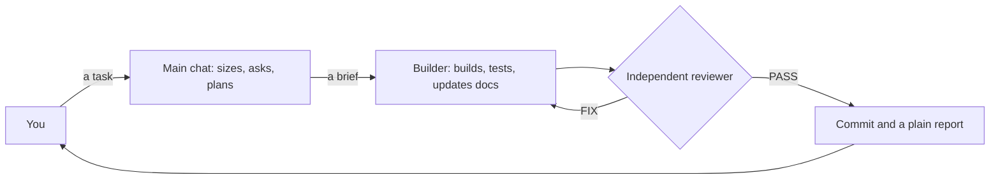

# claude-kit

**You manage. Agents build. Hooks enforce.**

claude-kit is a plug-and-play setup for Claude Code: install it once and it works on every project. Your main chat becomes a manager's seat, helper agents do the hands-on work, and hooks block the mistakes a written rule can only ask Claude to avoid.

## What it fixes

| Problem | How claude-kit fixes it |
|---|---|
| Claude is verbose and tiring to follow | Short, plain answers (a hook restates the style with every message), plus a short "Under the hood" part for the engineer. |
| The main chat fills up and accuracy drops | The main chat stays a clean manager: a hook blocks hands-on tools there, so helpers do that work in fresh context. |
| Every job runs on the priciest model | The right model per job: Sonnet builds and researches, Opus plans and always reviews, Haiku runs quick checks. |
| Docs chaos: journals, `_final` copies, a CLAUDE.md nobody reads | One docs standard that a hook and CI enforce, module skills that give agents each module's rules, and a plain-English guide per module. |
| Rules in CLAUDE.md get ignored | The rules that matter are backed by hooks, permission rules and the sandbox, which block the action itself. Gates count only new problems, so they work in a messy repo from day one. |
| No real process | Tasks sized small, normal or big, questions only where they matter, plans you approve, and a stop gate that waits for an independent reviewer's PASS. |
| Code and tests that look fine and prove nothing | Clean-code rules with every edit linted, real HTTP tests in the order the frontend calls the API, and secrets scanned on every edit and commit. |
| Agents misbehave | Helpers are told to commit only their own work and to stop at a missing credential; the sandbox blocks `~/.ssh`, and each PASS is tied to the exact code reviewed. |
| Every new project needs it all wired up again | `/kit:new` and `/kit:adopt` set up the linters, git hooks, CI and docs, with packs for Django, React + Vite, Next.js + Supabase and MERN. |

[How it works](docs/guides/how-it-works.md) shows which of these a hook enforces and which are instructions to the agents.

## Quickstart

### 1. Check what you need

You need Claude Code (`claude` on your `PATH`), git 2.31 or later, bash and Python 3.11 or later.

```bash
claude --version && git --version && python3 --version
```

### 2. Clone the kit

Any folder works, since the installer runs from wherever you clone it.

```bash
git clone https://github.com/WaqarAhmad321/claude-kit ~/claude-kit
```

### 3. Install it

This links the kit's profile, rules and output style into `~/.claude`, merges its settings, installs the `kit` plugin and turns on the sandbox. It backs up anything it replaces, your own `~/.claude/CLAUDE.md` included, and it's safe to re-run.

```bash
~/claude-kit/install.sh
```

It opens `~/Work` to Claude. If your projects live elsewhere, run `KIT_WORK_DIR=~/Code ~/claude-kit/install.sh` instead.

### 4. Load it

Start a new Claude Code session, or run this in one that's already open.

```text
/reload-plugins
```

### 5. Point it at a project

Open Claude Code in an empty folder and run `/kit:new` to start a project from a stack pack. In a repo you already have, run `/kit:adopt` instead: a read-only audit first, then changes one group at a time, each as you approve it.

```text
/kit:new
/kit:adopt
```

### 6. Give it a task

Ask for a real change, such as:

```text
Add a published_at field to posts and show it on the list page.
```

The main chat sizes the task and asks only what it can't look up. A builder makes the change and proves it over real HTTP, a reviewer checks it cold, and you get a few plain sentences: what works now, how it was checked, and what needs your decision.

### Good to know

- **The main chat won't edit or read code itself.** That's orchestrator mode. Type `! touch ~/.claude/kit-direct-mode` to let it work directly, and `! rm ~/.claude/kit-direct-mode` to switch back.
- **Make it yours.** This is the author's own setup: `home/CLAUDE.md` is his personal profile, and the `autoMode` part of `settings/settings.kit.json` describes his work. Replace both with your own, then re-run `install.sh`.
- **Turn it off.** Run `claude plugin disable kit@claude-kit` yourself (Claude is denied it). That stops the plugin's hooks, skills and agents; orchestrator mode is a settings hook, so direct mode lifts it. Everything `install.sh` replaced is in `~/.claude/backups/` ([roll back](docs/runbooks/deploy.md#roll-back)).

## How it works in one picture



Hooks check every edit, command and commit on the way, and a stop gate pushes back when a session tries to finish with new lint or type errors, tests not re-run since the code changed, or no review.

## Learn more

- [How it works](docs/guides/how-it-works.md): the agents, the workflow, every enforced rule, agent safety, testing, stack packs and escape hatches.
- [The docs standard](home/rules/docs.md) every repo follows, and [the testing rules](home/rules/verification.md).
- [Install, update and roll back](docs/runbooks/deploy.md), including everything `install.sh` changes.
- [Stack packs](templates/README.md): how each pack is laid out and applied.
- [Using the kit with other agents](docs/guides/using-the-kit-with-other-agents.md): Codex, Cursor, Gemini CLI, OpenCode and Copilot.
- [The kit plugin](plugins/kit/README.md): every hook, what it blocks, and its failure policy.
- [The decision records](docs/README.md#decisions) behind the design, and [the docs index](docs/README.md).
- [Changing the kit](CLAUDE.md): the worktree rule, tests and commit rules.
- [MIT license](LICENSE), copyright (c) 2026 Waqar Ahmad.
