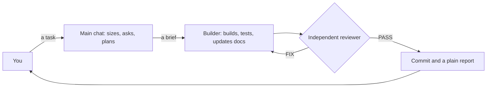

# claude-kit

**You manage. Agents build. Hooks enforce.**

claude-kit is a plug-and-play setup for Claude Code: install it once and it works on every project. Your main chat becomes a manager's seat, helper agents do the hands-on work, and hooks block the mistakes a written rule can only ask Claude to avoid.

## The problems it solves

Claude Code is powerful, but AI coding agents fail in familiar ways. Each block below names one and says what the kit does about it. Some fixes are hooks that block the action itself; others are instructions the agents follow.

### 1. Claude is verbose and tiring to follow

It narrates every step and fills the chat with function names, code and diffs. You end up reading instead of deciding.

- The "Product level" output style keeps answers short and plain: what changed, why it matters, and what needs you.
- A hook repeats that style next to every message you send, so it holds in long sessions and after compaction.
- When finished work has a mechanism worth knowing, the reply adds a short "Under the hood" part: how it works, where it lives, and the tradeoff. You still learn how it was built, not just that it changed.

### 2. The main chat fills up and accuracy drops

Every file read, diff and test log lands in the same conversation. The longer it grows, the less precise Claude gets.

- The main chat becomes a clean manager and architect chat: it plans, decides and reports. This is orchestrator mode.
- A hook enforces it. It blocks hands-on tools in the main chat (edits, shell commands, reading code, web research), so that work goes to helpers.
- Each helper (a subagent) starts with fresh, focused context and a complete brief. Less noise means more accurate work.
- You stay the manager: you make the calls, and the main chat stays short enough to follow.

### 3. Cost

Running every job on the biggest model is expensive. A long chat also re-reads its whole history on every turn.

- The right model per job. The agents' own files set the defaults: Sonnet for the builder and researcher, Opus for the reviewer.
- The workflow rule asks for Opus when planning, for every review and for hard or risky work (auth, permissions, money, migrations, deleting data, an API a shipped app uses), and Haiku for quick status checks. That's an instruction to the main chat, not a lock.
- The same rule escalates instead of overspending up front: a Sonnet builder that fails the same task twice is retried on Opus.
- File dumps and test logs stay in short-lived helpers, so the main chat doesn't carry them through every turn.

### 4. Docs chaos

Agents write journals, per-task reports, plan files and `_final` copies, and grow a CLAUDE.md nobody reads to the end. Soon no one knows which doc is true.

- One docs standard for every repo: a small required set (README, a CLAUDE.md of 150 lines at most, a docs index, decision records, a deploy runbook) and a list of banned kinds of files.
- A docs guard stops banned file names as they're written, and a docs check runs in CI.
- Module skills give agents accurate knowledge, one folder per module in `.claude/skills/<module>/`:
  - `SKILL.md` (rules and settled decisions), `FLOWS.md` (user journeys in call order), `LESSONS.md` (one rule per past bug, with its test) and `INTERLINKING.md` (links to other modules).
  - `CONTRACTS.md` and `SCHEMA.md`, generated from the OpenAPI schema and the models, never written by hand.
  - A guard denies edits to a module's files until the agent has read its skill.
- A plain-English `ARCHITECTURE.md` per module explains it for people, so you stay in the loop.
- Short decision records (ADRs) keep the why behind big choices, and a generated `AGENTS.md` gives the same rules to other coding tools.

### 5. Rules get ignored

A rule in CLAUDE.md is only a request. Deep into a long task, Claude forgets it or decides this case is different.

- A hook is a script Claude Code runs around an action. It sees the real edit, command or commit and can block it, however long the session and however sure the model is.
- The kit's enforcers:
  - secret scanning on every edit, shell command and commit
  - a commit guard that denies AI attribution lines
  - protected gate files: changes to lint, type, test, CI and kit config ask you first
  - a docs location guard that denies scratch doc names
  - a module-skill guard that denies edits before the skill is read
  - a review gate that blocks a session from finishing a non-trivial change without a reviewer's PASS. By default that's more than 50 changed lines, or any change to auth, billing, payments, permissions, security or migrations.
- Gates are ratchets: only new problems count. You can turn them on in a messy legacy repo on day one.

### 6. No real process

Left alone, an agent jumps into code, asks the wrong questions or none, and calls a task done because it says so.

- Every task is sized small, normal or big, and each size has its own steps.
- A clarify step asks only what changes the result, as multiple choice with a recommended answer. Everything else gets a stated default you can correct.
- Big work gets a written plan, and nothing is built until you approve it.
- The builder does a critical re-read, then updates the docs, so one review covers both. An independent Opus reviewer reads the change cold and must say PASS. "Done" needs evidence for each criterion: a check passed only if its summary line says so.
- The sizes, questions and plans are instructions; the review gate is enforced.

### 7. Tests that pass while features are broken

AI-written tests often mock everything and check the code against itself. They go green while the real feature fails.

- Test the way the frontend calls the API: real HTTP journeys in call order, a role matrix (anonymous, owner, other user, admin), the error paths, and a check that user A can't touch user B's data. The testing rule asks for this in every project.
- The Django and MERN packs ship it ready, with Hurl journeys, a role matrix and Schemathesis fuzzing, and their test stacks force paid API keys empty. The React + Vite and Next.js packs run Playwright flows per role.
- Unit tests only for pure logic, and every bug fix starts with a test that fails first. The stop gate holds a session while watched code changed since the last green journey run.
- Secrets are scanned on every edit, command and commit. Clean-code rules (no diary comments, named constants, small functions with one job) come with strict linters, and each edit is linted as it lands.

### 8. Agents misbehave

Helpers commit on their own, go hunting for credentials when a push fails, leave work in temp folders that vanish, or get credit for a review of someone else's work.

- Builders don't spawn forks, copies of themselves that could commit too. Only the builder commits, only its own work, and only when its brief says so. These are instructions in the agents' files.
- A helper that hits a missing credential stops and reports it instead of hunting for logins. That's an instruction too, backed by the sandbox's block on `~/.ssh` and AWS credentials and deny rules on reading `.env` files.
- Helpers' work copies stay on disk inside the project, never in `/tmp`, so a restart can't wipe them. That's a kit rule.
- Each PASS counts only for the exact work it reviewed: the checkout the reviewer named, as it was then, plus a small follow-up (15 lines by default). The review hook enforces this.

### 9. Starting or adopting a project is painful

Every new project means wiring up rules, linters, git hooks, CI and docs again, and an old repo is worse.

- `/kit:new` starts a project from a stack pack. `/kit:adopt` brings in an existing repo: a read-only audit first, then changes you approve group by group. `/kit:skills-bootstrap` drafts module skills from the code and its fix history, for you to review.
- Stack packs for Django, React + Vite, Next.js + Supabase and MERN, each with strict linters, git hooks, CI and a test setup.
- Codex, Cursor, OpenCode and Copilot read the same rules from the generated `AGENTS.md`, and Gemini CLI reads it through a small adapter.
- Only Claude Code runs the kit's hooks, so git hooks and CI enforce the checks no matter which tool wrote the code.

[How it works](docs/guides/how-it-works.md) marks which fixes a hook enforces and which are instructions, with every enforced rule, agent safety, testing, the stack packs and the escape hatches.

## Quickstart

### 1. Check what you need

You need Claude Code (`claude` on your `PATH`), git 2.31 or later, bash and Python 3.11 or later.

```bash
claude --version && git --version && python3 --version
```

### 2. Clone the kit

Any folder works, since the installer runs from wherever you clone it.

```bash
git clone https://github.com/WaqarAhmad321/claude-kit ~/claude-kit
```

### 3. Make it yours

This is the author's own setup. `home/CLAUDE.md` is his personal profile, and the `autoMode` part of `settings/settings.kit.json` describes his work. Replace both with your own before you install, since the installer links the first into `~/.claude` and merges the second into your settings.

### 4. Install it

This links the kit's profile, rules and output style into `~/.claude`, merges its settings, installs the `kit` plugin and turns on the sandbox. It backs up anything it replaces, your own `~/.claude/CLAUDE.md` included, and it's safe to re-run.

```bash
~/claude-kit/install.sh
```

It opens `~/Work` to Claude. If your projects live elsewhere, run `KIT_WORK_DIR=~/Code ~/claude-kit/install.sh` instead.

### 5. Load it

Start a new Claude Code session, or run this in one that's already open.

```text
/reload-plugins
```

### 6. Point it at a project

Open Claude Code in an empty folder and run `/kit:new` to start a project from a stack pack. In a repo you already have, run `/kit:adopt` instead: a read-only audit first, then changes one group at a time, each as you approve it.

```text
/kit:new
/kit:adopt
```

### 7. Give it a task

Ask for a real change, such as:

```text
Add a published_at field to posts and show it on the list page.
```

The main chat sizes the task and asks only what it can't look up. A builder makes the change and proves it over real HTTP, a reviewer checks it cold, and you get a few plain sentences: what works now, how it was checked, and what needs your decision.

### Good to know

- **The main chat won't edit or read code itself.** That's orchestrator mode. Type `! touch ~/.claude/kit-direct-mode` to let it work directly, and `! rm ~/.claude/kit-direct-mode` to switch back.
- **Turn it off.** Run `claude plugin disable kit@claude-kit` yourself (Claude is denied it). That stops the plugin's hooks, skills and agents. The rest stays until you remove it: the orchestrator guard and the style reminder (hooks in `~/.claude/settings.json`; direct mode lifts the guard), the sandbox settings and deny rules in that same file, and the linked `CLAUDE.md`, rules and output style. To remove them, take the kit's entries out of `~/.claude/settings.json` (or restore your pre-kit copy from `~/.claude/backups/`), then delete the links `install.sh` made in `~/.claude` and move back anything it saved in `~/.claude/backups/kit-<timestamp>/` ([roll back](docs/runbooks/deploy.md#roll-back)).

## How it works in one picture



Hooks check every edit, command and commit on the way, and a stop gate pushes back when a session tries to finish with new lint or type errors, tests not re-run since the code changed, or no review.

## Learn more

- [How it works](docs/guides/how-it-works.md): the agents, the workflow, every enforced rule, agent safety, testing, stack packs and escape hatches.
- [The docs standard](home/rules/docs.md) every repo follows, and [the testing rules](home/rules/verification.md).
- [Install, update and roll back](docs/runbooks/deploy.md), including everything `install.sh` changes.
- [Stack packs](templates/README.md): how each pack is laid out and applied.
- [Using the kit with other agents](docs/guides/using-the-kit-with-other-agents.md): Codex, Cursor, Gemini CLI, OpenCode and Copilot.
- [The kit plugin](plugins/kit/README.md): every hook, what it blocks, and its failure policy.
- [The decision records](docs/README.md#decisions) behind the design, and [the docs index](docs/README.md).
- [Changing the kit](CLAUDE.md): the worktree rule, tests and commit rules.
- [MIT license](LICENSE), copyright (c) 2026 Waqar Ahmad.
