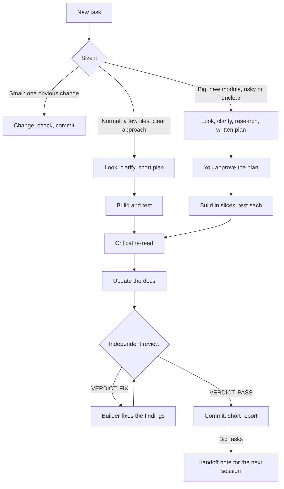

# How claude-kit works

What each part of the kit does, what enforces it, and how to switch parts off. The [README](../../README.md) has the short version and the install steps; [the architecture doc](../architecture/overview.md) has the principles and known limits.

## The main chat and its helpers

You talk to one main chat. It plans with you, asks what it must, briefs helpers, and reports back in plain English. Helpers do the hands-on work in the background, in parallel when the pieces don't overlap.

- **Short answers.** The "Product level" output style keeps answers short and plain: what changed, why it matters, and what needs you. A hook repeats that style next to every message you send, so it holds in long sessions and after compaction. When finished work has a mechanism worth knowing, the reply adds a short "Under the hood" part: how it works, where it lives, and the tradeoff.
- **Orchestrator mode.** A hook blocks hands-on tools in the main chat (edits, shell commands, reading code, web research), so that work goes to helpers. Each helper (a subagent) starts with fresh, focused context and a complete brief. Only architecture and decisions live in the main chat. Even the kit's own block messages there are three short lines, with the full report in a file a helper reads.

| Who | Model | Job |
|---|---|---|
| Main chat | Your session's model | Plans and decides with you, briefs helpers, reports back |
| Explore agents, built into Claude Code | Their default | Search the code and return conclusions, not file dumps |
| `kit:researcher` | Sonnet | Checks facts in current docs, with sources. Changes nothing |
| `kit:builder` | Sonnet, or Opus for hard or risky work | Builds, tests, re-reads its work, updates the docs, commits when told |
| `kit:reviewer` | Opus, always | Reads the change cold across ten areas, from correctness and security to operations. Read-only. Ends with `VERDICT: PASS` or `VERDICT: FIX` |

The agents' files set the builder and researcher to Sonnet and the reviewer to Opus. The rest of the model split is in the [workflow rule](../../home/rules/workflow.md): Opus also plans and takes hard or risky work (auth, permissions, money, migrations, deleting data, an API a shipped app depends on), Haiku handles quick read-only status checks, and a builder that fails the same task twice is retried on Opus.

## The task workflow

Every task is sized small, normal or big, and each size has its own steps. A clarify step asks only what changes the result, as multiple choice with a recommended answer; everything else gets a sensible default, stated so you can correct it. Big tasks get a written plan you approve, then get built in slices, each tested before the next. Then come a critical re-read, the docs, and an independent Opus reviewer that must say PASS. "Done" needs evidence: a check passed only if its summary line says so.



The sizes, the clarify step and the plans are instructions in the workflow rule and its skill. The review is enforced. The docs come before the review, so one review covers the code and the docs together. The review gate doesn't trust the size label. By default, a change of more than 50 lines, or any change to auth, billing, payments, permissions, security or migrations, needs a PASS before the session can finish. Merging one reviewed branch into an unchanged checkout needs no second review when its worktree was made before any other work of the session was committed there. Otherwise, and after merging two or more branches, the merged result needs one review of its own.

### A task, start to finish

Ask for "add a `published_at` field to posts and show it on the list page", and with no extra prompting:
1. The main chat says the size (normal: a few files, one module) and asks only what it can't look up.
2. A builder reads the module's skill (a hook blocks its edits until it has), builds the change, and adds a journey that proves the field over real HTTP.
3. It re-reads its work and updates the docs. The reviewer reads the change cold, and the stop gate holds until it says PASS.
4. You get a few plain sentences: what works now, how it was checked, and anything you need to decide.

## Enforced, not requested

A rule in CLAUDE.md sits in the context next to everything else. In a long session it gets diluted, summarised away, or argued around. A hook is different: it's a script Claude Code runs around an action. It sees the real edit, command or commit and allows or blocks it, every time, however long the session and however sure the model is. So the kit keeps the rules as guidance and puts a lock on the ones that matter.

| Rule | What enforces it |
|---|---|
| No secrets in code or commands | A secret scan on every edit and shell command, and on the staged files at commit. Betterleaks in the project's git hooks and CI |
| Clean commits | The commit guard denies AI attribution lines, a subject that isn't a Conventional Commit of 72 characters or less, and `.env` or local settings files |
| Every bug fix ships with its test | The commit guard denies a `fix:` commit that adds no test case |
| Read a module's skill before changing it | Edits to the module's files are denied until its skill is loaded. A stop check catches changes made through shell commands |
| Docs stay in their place | The docs guard denies scratch names (summary, plan, final, `v2`, dates) and asks before a new kind of doc |
| No new lint or type errors | Each edit is linted as it lands. The stop gate blocks finishing on new lint errors, suppression comments included, and on type errors beyond a recorded baseline |
| Tests are current | The stop gate blocks finishing while watched code changed since the last green journey run |
| Review before done | The stop gate blocks finishing a non-trivial change without a reviewer's PASS |
| The main chat stays clean | The orchestrator guard denies hands-on tools in the main chat |
| Gates stay as strong as they were | Changes to lint, type, test, CI and kit config ask you first, and the stop gate reports them. A session can't loosen its own review |
| Claude can't switch the kit off | Plugin disable and uninstall commands are denied. Settings and hook files ask you first. Only you can turn on direct mode |

Three properties keep this practical:
- **Ratchets.** Lint errors are compared with where the session started, type errors with a recorded baseline, and the review counts only this session's changes. Old problems don't block new work, so the gates run in a messy legacy repo from day one.
- **Fail closed.** If a guard or a stop check itself breaks, it blocks and says how to fix it or bypass it on purpose. A broken stop check blocks once, then lets Claude stop on the next try and warns you, so it can't trap Claude. The orchestrator guard is the exception: it fails open with a notice, so a bug there can't lock the main chat. A check never skips without telling you.
- **Never stuck.** The stop gate blocks at most 3 times in a row on the same findings, and 5 times in total, then lets Claude stop and tells you once.

## Docs that stay small

Every repo gets the same small set: `README.md`, a `CLAUDE.md` of 150 lines or fewer, a docs index in `docs/README.md`, decision records in `docs/decisions/`, and a deploy runbook. Some projects add an architecture overview, API docs with a generated OpenAPI schema, or guides. A docs guard stops banned files as they're written, and a docs check runs in CI. [The docs rule](../../home/rules/docs.md) has the full standard.

Banned outright: dated journals, per-task summary, plan, report or notes files, status ledgers, versioned copies, bug-log chronicles and hand-copied schemas. Their content goes to the commit message, the PR, the PM board, or a lessons rule with its test.

Each module keeps its knowledge in `.claude/skills/<module>/`:
- `SKILL.md`: the module's rules and settled decisions. Agents load it before touching the module.
- `ARCHITECTURE.md`: the module explained for a person, in plain English. A new module skill without one blocks finishing.
- `INTERLINKING.md`, `FLOWS.md` and `LESSONS.md`: links to other modules, user journeys in call order, and one rule per past bug with its test.
- `CONTRACTS.md` and `SCHEMA.md`: generated from the OpenAPI schema and the models, never written by hand.

`/kit:skills-bootstrap` drafts these from the code and its fix history, for you to review. Decisions go into short decision records (ADRs), and a generated `AGENTS.md` gives the same rules to other coding tools.

## Code quality and testing

Rules load where they apply. Code style, verification, workflow, git commits and working with agents load in every session. Stack rules for Django, API design, React, Next.js, Node/Express and MongoDB load only when Claude touches a matching file, so the always-on context stays small.

The code-style rules ask for no diary comments, named constants, small functions with one job, and no insecure defaults. After each edit, a hook fixes what's safe to fix, formats the file if it was formatted before, and reports any lint problem the edit added. Adding a `# noqa` or `eslint-disable` counts as a new problem too. The stack packs ship strict linters. The Django pack caps complexity and flags magic numbers, commented-out code and boolean flag arguments. The React + Vite and Next.js packs cap complexity, file size and function size. The Django and MERN packs also check that code keeps to its layers.

Testing follows the frontend, not the file tree:
- Hurl journeys in the order the client calls the API, with the error paths (400, 401, 403, 404, 405, 409, never a 5xx).
- A role matrix over real HTTP: anonymous, owner, other user and admin, so user A can't touch user B's data.
- Schemathesis fuzzing per role for the APIs, and Playwright flows per role for the frontends.
- Unit tests only for pure logic, and a regression test that fails first for every bug fix.
- Everything runs against a local stack, never production. The Django and MERN test stacks force paid API keys empty.

Secrets are scanned on every edit, command and commit, and the independent review covers correctness and security. The kit tests itself too, with over 1,100 tests. The hook tests run each hook with real hook input in temporary git repos.

## Agent safety

| Risk | What the kit does | How it holds |
|---|---|---|
| A helper commits on its own | Only the builder commits its own work, when its brief says so. It doesn't spawn forks, copies of itself that could commit too, and read-only helpers are told not to edit, commit or push | The agents' instructions |
| A helper hunts for credentials | It stops and reports the missing credential instead | Instructions, the sandbox's block on `~/.ssh` and AWS credentials, and deny rules on reading `.env` |
| Work lost in a temp folder | Helpers' worktrees live inside the project, never in `/tmp`, each finished piece committed on its own branch and merged only after review | A kit rule |
| A PASS covers work it never saw | Each PASS is stamped on the checkout the reviewer names, as it was when reviewed. Another checkout gets credit only for that same code, or a small follow-up to it of up to 15 lines | The review hook |
| A destructive git command | Force-push and `git add -f` are denied. `git reset --hard` and `git clean -f` ask first | Permission rules |

## Stack packs

| Pack | What a project gets |
|---|---|
| Django | DRF on PostgreSQL with PostGIS and Redis. Strict ruff and mypy, import-linter layers, and a Docker test stack with Hurl journeys, a role matrix and Schemathesis |
| React + Vite | Type-aware oxlint, strict TypeScript, knip and jscpd, and Playwright with one signed-in state per role |
| Next.js + Supabase | The same frontend gates, Supabase's security advisors in CI, and Playwright per role against local Supabase |
| MERN | Express 5 and React + Vite in one repo. A MongoDB test stack with migrations, Hurl journeys, a role matrix and Schemathesis |

Every pack sits on the common pack: the docs skeleton and docs check, lefthook git hooks (secret scan, commit message rules), CI, and the gate settings in `.claude/kit.json`. See [templates/README.md](../../templates/README.md).

## Other coding agents

`/kit:new` generates an `AGENTS.md` from the same rules. Codex, Cursor, OpenCode and Copilot read it on their own, and `templates/agents/` has small adapters for Gemini CLI and Copilot. Only Claude Code runs the kit's hooks, so lefthook and CI are the layer every agent shares: the checks hold whichever tool wrote the code. See [Using the kit with other agents](using-the-kit-with-other-agents.md).

## Escape hatches

- `KIT_SANDBOX=0 ./install.sh` installs without the sandbox.
- `KIT_WORK_DIR=~/Code ./install.sh` opens another folder instead of `~/Work`.
- `KIT_BYPASS=<hook1,hook2|all> claude` skips named hooks, or all of them, for one launch. It counts only from your shell, so Claude can't set it for itself in a settings file.
- Direct mode lifts orchestrator mode for every session: `! touch ~/.claude/kit-direct-mode` turns it on and `! rm ~/.claude/kit-direct-mode` turns it off. A scripted headless run sets `KIT_DIRECT_MODE=1` instead.
- `gate.review` in a repo's `.claude/kit.json` tunes the review gate (`min_lines`, `always`) or turns it off (`enabled: false`). A change there applies from the next session.
- `{"enabledPlugins": {"kit@claude-kit": false}}` in a project's `.claude/settings.json` (or `.claude/settings.local.json` if that file isn't tracked) turns the plugin off there.
- `claude plugin disable kit@claude-kit` turns the plugin off everywhere. Run it yourself; Claude is denied that command.
- Either way, the orchestrator guard and the style reminder stay on: they're hooks in `~/.claude/settings.json`, not in the plugin. Direct mode lifts the guard.
- `git revert <sha>` in the kit, then `./install.sh`, rolls back a kit change. Settings backups are in `~/.claude/backups/`.

## Repo layout

```text
claude-kit/
├── install.sh          one-step install, safe to re-run
├── home/               CLAUDE.md, rules, the output style and two hooks (orchestrator, style), linked into ~/.claude
├── settings/           permission, hook, style and sandbox settings that install.sh merges
├── plugins/kit/        the plugin: hooks, agents, skills, scripts and tests
├── templates/          the common pack, one pack per stack, and adapters for other agents
└── docs/               the docs index, architecture, decisions, runbooks and guides
```
